# Carga masiva de datos (Etapa 3)

Informe de la etapa: cómo se generó y cargó el historial, qué decisiones se tomaron frente a los triggers y cómo se validó el resultado. Los pasos para ejecutarla están en [db/seed/README.md](../db/seed/README.md).

Todos los números de este informe salen de ejecuciones reales desde volúmenes vacíos, con `SEMILLA=20260427`, `FECHA_REFERENCIA=2026-10-27` y `ESCALA=1`, salvo que se indique otra cosa.

## 1. Catálogos y fuentes

Los catálogos no se generan al azar: están en `db/seed/catalogos/` en CSV.

- Cepas, maridajes, departamentos, tipos de vino y presentaciones salen del Anexo B de la consigna.
- Las 37 localidades de Mendoza tienen su código postal verificado contra una fuente. Dos no se pudieron confirmar y quedaron afuera: Cuadro Benegas y "Junín" (se usa "Villa de Junín", como figura en la fuente).
- Se agregan tres cepas reales sin uso (Petit Verdot, Viognier, Pedro Giménez) para que D2 tenga resultado.

El detalle y los enlaces a las fuentes están en el README de `db/seed`.

Nombres de bodegas, fincas, clientes, empleados, encargados y transportistas: Faker `es_AR` con semilla fija.

## 2. Orden de carga según las claves foráneas

Una tabla se carga después de todas las tablas a las que referencia. Las flechas van de la tabla referenciada a la que la referencia. El generador carga en este orden; los stocks van al final porque se calculan desde los movimientos.

```mermaid
flowchart LR
  subgraph N0[Nivel 0: sin dependencias]
    departamento; localidad; cepa; bodega; maridaje; transportista
  end
  subgraph N1[Nivel 1]
    sala_venta; finca; vino; cliente; transportista_localidad
  end
  subgraph N2[Nivel 2]
    empleado; parcela; composicion_vino; vino_maridaje; auditoria_precio
    socio_club; distribuidor; exportador; ingreso; transferencia; stock_deposito
  end
  subgraph N3[Nivel 3]
    lote_uva; permiso_exportacion; renglon_ingreso; renglon_transferencia; comprobante; stock_sala
  end
  subgraph N4[Nivel 4]
    analisis_calidad; renglon_comprobante
  end
  localidad --> sala_venta & cliente & transportista_localidad
  departamento --> finca
  bodega --> vino & ingreso & lote_uva
  transportista --> transportista_localidad & ingreso
  sala_venta --> empleado & transferencia & comprobante & stock_sala
  finca --> parcela
  cepa --> parcela & composicion_vino
  vino --> composicion_vino & vino_maridaje & auditoria_precio & stock_deposito & stock_sala
  vino --> renglon_ingreso & renglon_transferencia & renglon_comprobante
  maridaje --> vino_maridaje
  cliente --> socio_club & distribuidor & exportador & comprobante
  exportador --> permiso_exportacion
  parcela --> lote_uva
  ingreso --> renglon_ingreso
  transferencia --> renglon_transferencia
  lote_uva --> analisis_calidad
  comprobante --> renglon_comprobante
```

## 3. Estrategia frente a los triggers

### 3.1 Qué triggers chocan con una historia

| Trigger | Por qué choca |
|---|---|
| `trg_renglon_comprobante_completar` | Pone el precio y el descuento **actuales**, exige el stock **de hoy** y rechaza renglones de comprobantes de otra transacción (RN-12). |
| `trg_renglon_comprobante_impactar` | Descuenta stock y recalcula la cabecera fila por fila: medio millón de veces. |
| `trg_ingreso_estado`, `trg_transferencia_estado` | Sólo permiten dar de alta documentos en confección; la historia los tiene procesados. |
| `trg_renglon_ingreso_bloqueo`, `trg_renglon_transferencia_bloqueo` | No admiten renglones en documentos procesados. |
| `trg_transferencia_fecha` | Fuerza la fecha de hoy. |

### 3.2 Alternativas

| Alternativa | Ventajas | Desventajas |
|---|---|---|
| (a) `ALTER TABLE … DISABLE TRIGGER USER` en todas las tablas | Simple. | También apaga los constraint triggers diferidos (composición 100, totalidad de clientes, comprobantes con renglones). Nadie valida esos datos dentro de la base: todo queda a cargo de los controles posteriores. |
| (b) Cargar por las funciones y procedimientos reales | Cada fila pasa por todas las reglas. | **No puede producir historia**: `fn_registrar_venta` usa la fecha, el precio y el descuento de hoy, y la fecha de transferencia se fuerza a hoy. Además, cada venta recalcula su cabecera y bloquea filas. Sirve para operaciones nuevas, no para cargar el pasado. |
| **(a′) Deshabilitar sólo los 7 triggers de la tabla anterior, en una sola transacción** (elegida) | Los demás triggers siguen activos y validan la carga. En particular, los 8 constraint triggers diferidos verifican al confirmar la composición de cada vino, la totalidad de la jerarquía de clientes, el respaldo de U6 y que cada comprobante tenga renglones. `trg_comprobante_importes` acepta los importes sólo por el camino de recálculo. | Los 7 triggers deshabilitados no validan la historia: lo compensan los controles (sección 6). |

### 3.3 Garantías de (a′), todas verificadas

- **Las FK siguen activas.** Son triggers internos y `DISABLE TRIGGER` por nombre no los toca. Durante la carga, el script inserta a propósito un renglón huérfano y verifica que se rechaza con 23503.
- **Rehabilitación garantizada.** `ALTER TABLE … DISABLE TRIGGER` es transaccional. Se comprobó deshabilitando un trigger y provocando un error a mitad de la transacción: después del `ROLLBACK` el trigger volvió a `O` (habilitado). Además, el script verifica en un `finally`, desde una conexión nueva, que ningún trigger del esquema quedó en `tgenabled = 'D'`, y `controles.sql` lo vuelve a verificar.
- **No se usa `session_replication_role`:** exige superusuario, y la carga corre como propietario.
- **Las reglas siguen activas después.** `db/seed/post_carga.sql` ejecuta sobre la base cargada, por el camino normal, una venta con `fn_registrar_venta`, un ingreso y una transferencia con `sp_terminar_*` y `sp_procesar_*`, y un cambio de precio. Comprueba los rechazos esperados: RN-09 sin stock, **RN-12 al agregar un renglón a un comprobante cargado**, RN-10 al reprocesar un ingreso histórico, RN-11 por transferencia sin stock sin dejar cambios, y la auditoría de RN-13. Termina en `ROLLBACK`.

### 3.4 Riesgos

| Riesgo | Cómo se compensa |
|---|---|
| Precios o descuentos de renglones que no corresponden a la fecha de la venta | No los decide Python: los calcula SQL (sección 4) y un control compara cada renglón con el precio vigente según la auditoría y con `fn_descuento_cliente`. |
| Stock negativo en algún momento de la historia, aunque el final sea positivo | Control de **saldo corrido** con funciones de ventana: para cada vino y sala, el saldo acumulado en orden cronológico nunca baja de 0. |
| Documentos con estados imposibles (terminado o procesado sin renglones) | Control específico. |
| Fechas incoherentes (cosechas fuera de temporada, ventas antes del alta del cliente o de la añada, fechas futuras) | Siete reglas de coherencia en `controles.sql` (sección 4.3). |
| Que algún trigger quede apagado | Transacción única, `finally` y control de `tgenabled`. |

## 4. Coherencia de los datos

### 4.1 Quién calcula qué

La regla del proyecto es que totales, descuentos y stock pertenecen a PostgreSQL. Por eso:

- **Python sólo simula la historia** día por día, en orden cronológico. Decide fechas, quién compra qué y cuánto, y cuándo se repone. Lleva el stock en memoria únicamente para no vender lo que no hay.
- **PostgreSQL calcula al cargar:**
  - **Precio unitario histórico:** se deduce de los intervalos de `auditoria_precio`. Antes del primer cambio rige su precio anterior; después de cada cambio, su precio nuevo.
  - **Descuento:** `fn_descuento_cliente`.
  - **Subtotal del renglón:** la misma fórmula del `CHECK`.
  - **Importes de cabecera:** un `UPDATE` agregado con la misma aritmética que `fn_recalcular_comprobante`, por el camino que acepta el trigger.
  - **Stocks finales:** `INSERT … SELECT` desde los movimientos procesados.

Python genera la historia de precios: un ajuste por año por vino, de +15 % a +60 % (inflación). Quedan 3.617 cambios encadenados en la auditoría, con `usuario_bd = 'carga_historica'`.

**No se cargan excepciones del 35 %:** las asigna la consulta U6 en la Etapa 5. Por lo tanto, el descuento histórico de cada renglón es el base del tipo de cliente.

### 4.2 Período simulado

- **Comercio: 6 años**, hasta `FECHA_REFERENCIA`. Así D1 tiene comprobantes de socios de más de 5 años.
- **Uva: las 5 últimas campañas completas**, como sugiere el Anexo B. No se contradicen: la consigna no vincula lotes con vinos.
- **Documentos:**
  - los de más de 10 días (ingresos) o 7 días (transferencias) están procesados;
  - los más recientes quedan procesados, terminados o en confección (para S5 y `v_documentos_pendientes`); los pendientes no impactan el stock.

### 4.3 Reglas de coherencia del simulador

Ningún trigger las valida; `controles.sql` las verifica.

| Regla | Cómo la garantiza el simulador |
|---|---|
| R1. Comprobante con fecha ≥ alta del cliente | Cada venta elige entre los clientes ya dados de alta ese día. |
| R2. Ningún movimiento de un vino antes del 1/1 del año siguiente a su añada | Ingresos y transferencias ignoran el vino antes de esa fecha; las ventas sólo usan stock ya transferido. |
| R3. Renglones de un ingreso sólo con vinos de su bodega | Cada ingreso se arma con los vinos de una bodega. |
| R4. Análisis con fecha ≥ cosecha | Entre 0 y 20 días después de la cosecha. |
| R5. Ninguna fecha posterior a `FECHA_REFERENCIA` | Incluye altas, ingreso de empleados, emisión de permisos, auditoría, ventas, documentos, cosechas y análisis. |
| R6. Añadas coherentes | Entre `FECHA_REFERENCIA` − 10 y − 1 años; ninguna futura. |
| R7. Permisos emitidos hasta `FECHA_REFERENCIA`, vigentes y vencidos | Emisión en los últimos 6 años (y después del alta), vigencia de 1 a 3 años. |

### 4.4 Casos garantizados para la Etapa 5

`controles.sql` verifica 23 condiciones de cobertura, relativas a `FECHA_REFERENCIA`. Las principales:

- **U2:** empleados con más de 5 años.
- **U4:** salas que cierran lunes y salas que cierran miércoles.
- **U6:** exportadores con más de 3 permisos (cada exportador tiene entre 1 y 6).
- **I1:** existe General Alvear, y hay un transportista con un mínimo **único** de ingresos en el trimestre que no la cubre.
- **I2:** tintos de 14° a 15,5°.
- **I3:** la sala 1 tiene stock.
- **I6:** existe "Malbec Reserva" de 750 ml.
- **D1:** comprobantes de socios de más de 5 años.
- **D2:** 3 cepas sin uso.
- **D3:** la sala 2 tiene empleados de menos de 2 años.
- **D4 y D6:** socios sin compras, antiguos y en varias localidades.
- **D5:** ingresos procesados de más de un año.
- **S2:** 20 "vinos de línea" vendidos en las 40 salas.
- **S3:** ventas de la última semana con los tres tipos de cliente.
- **S4:** un vino transferido a 5 o más salas en los últimos 15 días.
- **S5:** transferencias pendientes en varias salas.
- **S6:** vinos sin stock en la sala 1 y con stock en el depósito.
- **S7:** un transportista claramente más activo en el último mes.
- **S10:** parcelas con varias campañas.
- **S12:** dos clientes compraron los tres vinos de una bodega chica, y hay clientes que nunca compraron tintos.

Las consultas de la Etapa 5 usan `CURRENT_DATE`: antes de la demo hay que regenerar con `FECHA_REFERENCIA` igual a la fecha del día (README de `db/seed`).

## 5. Volumen final

| Tabla | Filas | | Tabla | Filas |
|---|---:|---|---|---:|
| renglon_comprobante | **538.306** | | auditoria_precio | 3.617 |
| comprobante | **150.125** | | lote_uva | 3.081 |
| cliente | **20.000** | | exportador | 2.035 |
| renglon_transferencia | **15.464** | | vino_maridaje | 1.187 |
| socio_club | **13.961** | | composicion_vino | 867 |
| renglon_ingreso | **10.500** | | parcela | 657 |
| permiso_exportacion | 7.140 | | stock_deposito / vino | 600 / 600 |
| analisis_calidad | 6.073 | | empleado | 163 |
| transferencia | 5.088 | | transportista_localidad | 47 |
| ingreso | 4.084 | | sala_venta | 40 |
| distribuidor | 4.004 | | localidad | 37 |
| stock_sala | 4.000 | | finca | 30 |
| | | | bodega | 20 |
| | | | departamento | 18 |
| | | | cepa / transportista | 15 / 15 |
| | | | maridaje | 8 |

**Mínimos de la consigna:** las 30 tablas tienen filas; 6 superan las 10.000; una supera las 100.000 (y los renglones superan los 500.000 recomendados).

Con `ESCALA=0.1` (pruebas rápidas y nube): 2.000 clientes, 15.044 comprobantes y 54.218 renglones; los controles pasan con `-v minimo_mayor=10000`.

## 6. Consultas de control

`db/seed/controles.sql` informa todos los controles y termina con código 3 si alguno encuentra violaciones. Resultado sobre la carga completa: **55 controles, 0 violaciones**, y **35 FK revisadas sin huérfanos**. El recorrido de las 35 FK se arma desde `pg_constraint`, para demostrarlo en vez de suponerlo.

| Grupo | Controles | Qué verifica |
|---|---:|---|
| Volumen | 3 | Tablas sin filas; al menos 3 con más de 10.000; al menos 1 con más de 100.000. |
| Stock | 6 | Sin negativos; saldo final igual a los movimientos procesados (depósito y sala); saldo corrido nunca negativo en el tiempo. |
| Ventas | 6 | Total igual a `fn_total_comprobante` y a la suma de renglones; comprobantes con renglones; descuento igual al vigente; precio igual al vigente según la auditoría; auditoría encadenada; precio actual igual al último cambio. |
| Modelo | 6 | Composición 100; jerarquía de clientes completa y correcta; documentos terminados o procesados con renglones; cosechas en febrero a abril; sin excepciones cargadas. |
| Coherencia | 10 | R1 a R7 (R2 se verifica en ingresos, transferencias y ventas; R7 en vigentes y vencidos). |
| Triggers | 1 | Ninguno deshabilitado. |
| Cobertura | 23 | Condiciones para las consultas de la Etapa 5 (sección 4.4). |

**Los controles detectan errores reales:**
- con una sola fila de `stock_sala` alterada en +1, el control "stock de sala distinto de los movimientos procesados" informa 1 violación y el archivo termina con código 3; al restaurarla, vuelve a 0;
- sobre una base vacía fallan 27 controles.

Después de la carga, **`db/tests/run_all.sh` sigue pasando completo (7 de 7)**: ninguna prueba asumía una base vacía.

## 7. Tiempos

**Hardware:**
- Intel Core i5-12500H (12 núcleos, 16 hilos);
- Docker Desktop 29.2.1 con 7,6 GiB de RAM asignada;
- PostgreSQL 16 y el servicio `seed` en contenedores de la misma máquina.

### 7.1 Carga completa (`ESCALA=1`)

| Fase | Segundos |
|---|---:|
| Simulación de la historia en Python | 5,6 |
| `COPY` de las tablas generadas y del staging de renglones (la mayor, comprobante: 5,3 s) | ≈ 8,0 |
| `renglon_comprobante`: precio histórico, descuento y subtotal en SQL (538.306 filas) | 38,3 |
| Importes de cabecera en SQL (150.125 comprobantes) | 6,3 |
| Stocks desde movimientos | 0,3 |
| `COMMIT`, con los constraint triggers diferidos | 6,2 |
| **Total** | **≈ 65** |

La carga completa con los datos definitivos se ejecutó tres veces (A, B y F en la sección 8), con totales entre 64,3 y 65,5 s.

**Cola de constraint triggers diferidos.** Una sola transacción deja en cola unos 172.000 eventos hasta el `COMMIT`: 150.125 comprobantes, 20.000 clientes y sus subtipos, 600 vinos y 867 composiciones.

- **El `COMMIT` tarda entre 6,1 y 6,6 s** en las ejecuciones medidas.
- **La memoria del contenedor de la base** subió de 22 MiB en reposo a un **máximo de 173 MiB**, medida con `docker stats` cada segundo. El propietario no puede leer `pg_backend_memory_contexts`, así que no se midió la cola por separado.

Con esos números no hace falta partir la carga en bloques, y la transacción única conserva la garantía de rehabilitar los triggers con el `ROLLBACK`.

### 7.2 Fila por fila contra por lotes (paso 6)

Se mide lo que el script envía a la base, es decir los renglones de venta (538.306 filas), en una tabla temporal con clave primaria. La transformación posterior en SQL es igual para todos los métodos.

| Método | Filas medidas | Segundos | Filas/s | Total estimado |
|---|---:|---:|---:|---:|
| Fila por fila, un `COMMIT` por fila | 5.000 | 0,95 | 5.288 | 101,8 s (extrapolado) |
| Fila por fila, un solo `COMMIT` | 20.000 | 1,40 | 14.305 | 37,6 s (extrapolado) |
| Por lotes (`executemany`) | 538.306 | 10,03 | 53.665 | 10,0 s |
| `COPY` | 538.306 | 0,41 | 1.297.699 | 0,4 s |

`COPY` es unas **24 veces** más rápido que `executemany`, unas **90 veces** más rápido que fila por fila con un solo `COMMIT`, y unas **250 veces** más rápido que fila por fila con un `COMMIT` por fila. Fila por fila paga un viaje de ida y vuelta por fila y, con autocommit, también una escritura del registro de transacciones por fila. `executemany` agrupa los viajes (psycopg 3 usa el modo *pipeline*), pero sigue procesando una sentencia por fila. `COPY` envía todo como un único flujo de datos.

Las mediciones de fila por fila se hicieron sobre una muestra y se extrapolaron. La red es local entre contenedores: contra una base remota, como en la nube, la diferencia sería todavía mayor.

## 8. Reproducibilidad

Tres cargas independientes desde volúmenes vacíos produjeron las mismas huellas en las 30 tablas:

- **A:** la verificación;
- **B:** se ejecutó `run_all.sh` **antes** de cargar, de modo que las pruebas consumieron valores de las secuencias (la de comprobantes estaba en 5);
- **F:** la verificación final con el código definitivo.

Las claves explícitas con `setval` hacen que los datos no dependan del estado de las secuencias.

La huella es el md5 de todas las filas, en texto y ordenadas por la clave primaria (`db/seed/hashes.sql`). Se excluye `comprobante.xact_alta`, que es el identificador de la transacción de carga.

| Tabla | Filas | Huella md5 (A = B = F) |
|---|---:|---|
| analisis_calidad | 6.073 | `5855de6b2c2c1b5c2e85c2dbdc1f20cf` |
| auditoria_precio | 3.617 | `c199ac1e6b98833eb58171c850acfccf` |
| bodega | 20 | `60fea01e93323ff29115a8934986638e` |
| cepa | 15 | `24f2e356731727acf0911aa54b7477b6` |
| cliente | 20.000 | `eff233af724e06cbe67f071bd967eb05` |
| composicion_vino | 867 | `2aafd9dff5a12a5176a2cf8aa4747254` |
| comprobante | 150.125 | `7e42ddb27928116cadd9df04b73f6fc6` |
| departamento | 18 | `ec7a9d9abc793b757560ff8125c2ec8c` |
| distribuidor | 4.004 | `a2ce65de84eccb5483131ca31b29934b` |
| empleado | 163 | `79220f37fc7e9aefcf04291fe9679935` |
| exportador | 2.035 | `f6a72284d6562680f8af8a3e8bb2d769` |
| finca | 30 | `d9168b0cc49bc0778414c8097fd9b06d` |
| ingreso | 4.084 | `dc147b317af98dc7e83a4cd4e0535f55` |
| localidad | 37 | `b0c85b41920bde5ac922e36015e13392` |
| lote_uva | 3.081 | `a344e110b6fd58dd2a030fc103f15557` |
| maridaje | 8 | `a51bd540f3c8fb766578588787bdc75f` |
| parcela | 657 | `8b3bd951067f82dbc50f125f504f4ba3` |
| permiso_exportacion | 7.140 | `ac87abc7df7f2e7e8164c3887b7e3e56` |
| renglon_comprobante | 538.306 | `94f0a1239397acfd33657a057a1ce00c` |
| renglon_ingreso | 10.500 | `acddd1d5c55fc2c5ef38682301ea0862` |
| renglon_transferencia | 15.464 | `bf8d65a253ef9944a2c4644d9d24c7ab` |
| sala_venta | 40 | `7ca68afe8cd7223031b66c6a0d45743e` |
| socio_club | 13.961 | `b584aa32ee011cdd9c97f585b97878ed` |
| stock_deposito | 600 | `da6c5cc378873beafa59dd76f19e8375` |
| stock_sala | 4.000 | `704843b523c977d64ca48f8d96143df9` |
| transferencia | 5.088 | `64b8e87e91a0e605a380232fa9c1460e` |
| transportista | 15 | `49cc3e773be3d394f23903d3f8c728a3` |
| transportista_localidad | 47 | `d0510528cc7f078e6ba48eff553ce25e` |
| vino | 600 | `44f2f7846c4f670ab9ab42f47f1c53d5` |
| vino_maridaje | 1.187 | `a48afe7d659a5a4a5e9b430581eb9d4d` |

Las huellas dependen de las versiones fijadas: imagen `python:3.12.7-slim-bookworm`, `psycopg[binary]==3.2.3` y `Faker==33.1.0`.

## 9. Volcado

- **Tamaño:** `dump_completo.sql.gz` pesa **7,8 MB** comprimido (33,5 MB sin comprimir) y se genera en unos 5 s con `pg_dump --schema=bodegas` como propietario. **No se versiona**: `.gitignore` excluye `*.sql.gz`. Las instrucciones para generarlo y restaurarlo están en el README de `db/seed`.
- **Sin secretos:** se buscó `password`, `passwd`, las claves de ejemplo, `CREATE ROLE` y `ALTER ROLE`, sin coincidencias. `pg_dump` exporta sólo el esquema `bodegas`; los roles los crea el bootstrap.
- **Restauración verificada:**
  - en un volumen nuevo se levantó sólo `db`, se reemplazó el esquema por el del volcado en una transacción (2,5 s) y se levantó el resto;
  - `migrate` **omitió las 7 migraciones**, porque `schema_migration` viene en el volcado con los mismos checksums;
  - las huellas de las 30 tablas coincidieron con la base original, los controles dieron 0 violaciones, `run_all.sh` pasó y `/salud` respondió 200.
- **Por qué sin `--clean`:** la primera prueba de restauración usaba `--clean --if-exists` y falló. Su limpieza reemplaza las vistas por definiciones provisorias que usan tipos del esquema, y sobre una base recién inicializada esos tipos todavía no existen. Se cambió el procedimiento: volcado sin `--clean` y `DROP SCHEMA bodegas CASCADE` antes de restaurar.

## 10. Pendientes para la Etapa 4

- **Consultas para medir con `EXPLAIN (ANALYZE, BUFFERS)`:**
  - ventas por sala y período: S8, S11 y `v_ventas_mensuales_sala`, sobre `comprobante.fecha` e `id_sala`;
  - ranking de vinos: S1 y U5, sobre `renglon_comprobante.cod_vino`;
  - documentos pendientes: S5 y `v_documentos_pendientes`, candidatos a un índice parcial `WHERE estado <> 'procesado'`;
  - S3, con clientes por tipo en la última semana;
  - el precio vigente según la auditoría, por `(cod_vino, fecha_hora)`.
- **Tablas grandes para el costo de escritura de los índices:** `renglon_comprobante` (538.306 filas) y `comprobante` (150.125). El mismo `generar_datos.py medir` sirve de base para cronometrar la carga con y sin índices.
- **Paso SQL más lento de la carga:** el de los renglones (38 s), que hace la búsqueda del precio vigente por intervalos de la auditoría. Es un buen candidato para analizar con `EXPLAIN` en la Etapa 4.
