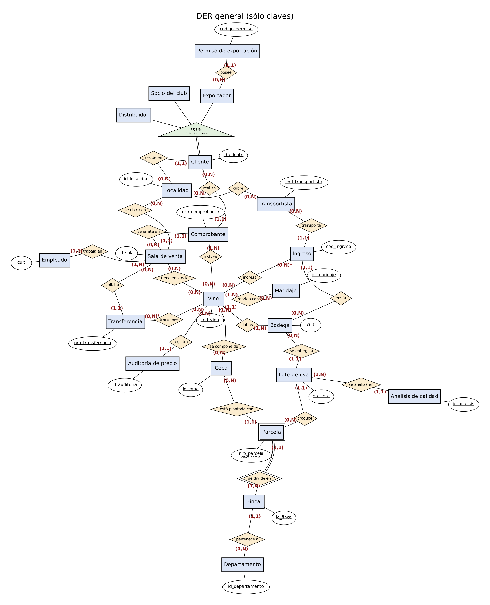
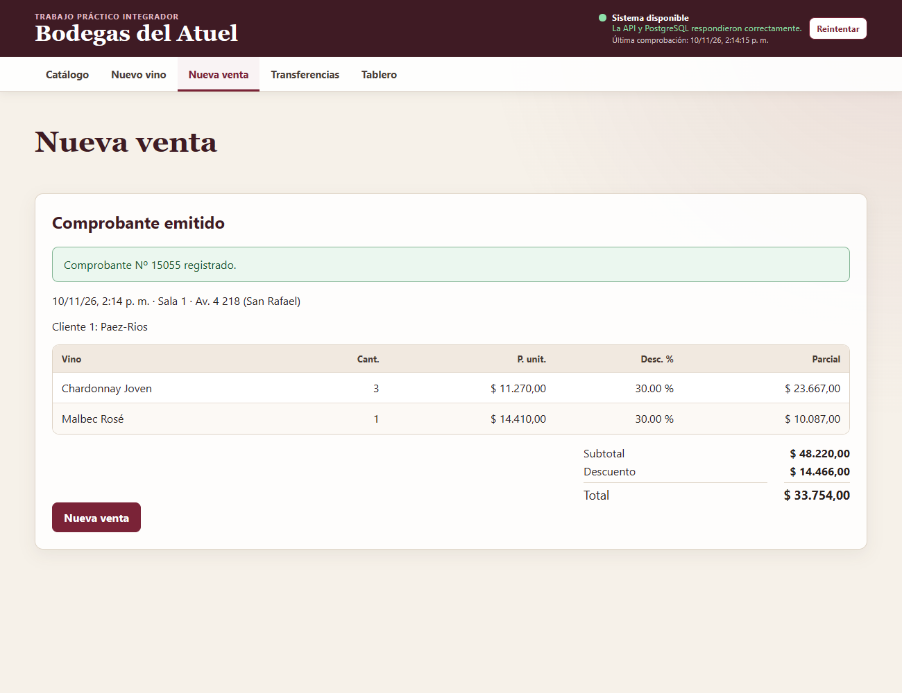
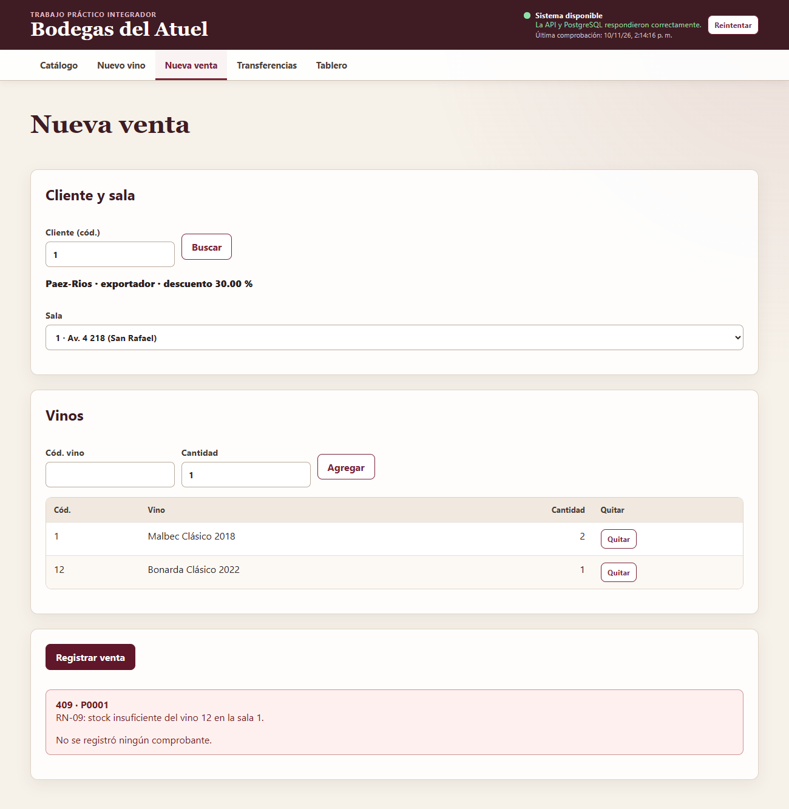

# Informe final · Bodegas del Atuel

**Trabajo Práctico Integrador · Bases de Datos 2026 · Ingeniería en Sistemas de Información · UTN Facultad Regional San Rafael**

**Integrantes:** Lucas Martínez y Dai Galdeano · **Repositorio:** https://github.com/Lukillas09/ProyectoFinalBD

**Versión en la nube:** front `https://bodegas-front-cq6q.onrender.com` · API y Swagger `https://bodegas-api-srvr.onrender.com/docs` (ver la sección 8 y [`cierre_etapa8.md`](cierre_etapa8.md)).

Este informe sigue la estructura de la consigna (§10.2) y reúne los informes parciales de cada etapa. Cada sección resume decisiones y resultados, y enlaza al documento con el detalle completo.

---

## 1. Introducción y alcance

Bodegas del Atuel es una red de salas de venta de vinos de San Rafael que compra a bodegas de la zona, guarda el stock en un depósito central y lo transfiere a las salas, donde se vende a tres tipos de clientes con descuentos distintos. El sistema cubre de punta a punta:

- **Base de datos PostgreSQL 16:**
  - el modelo y las reglas de negocio;
  - los cálculos de totales, descuentos y stock;
  - los roles y privilegios.
- **Carga masiva reproducible:** más de 538.000 renglones de venta generados con semilla fija.
- **Índices** con mejora medida.
- **48 consultas SQL** de la sección 8: S1–S12, U1–U6, I1–I6 y D1–D6.
- **API REST** en Python con FastAPI y Psycopg 3, sin ORM y con SQL parametrizado.
- **Front** en HTML, CSS y JavaScript sin frameworks, con cinco pantallas.
- **Despliegue en la nube** (Render), con HTTPS, conexión cifrada, acceso restringido y backup probado (sección 8).

**Principio rector del proyecto:** *las reglas, los importes y el stock pertenecen a PostgreSQL*. La API sólo invoca funciones y procedimientos y traduce sus errores; el front sólo muestra lo que devuelve la base. Así una regla se cumple igual si el dato llega por la API, por `psql` o por una carga masiva.

**Alcance y aclaraciones** (detalle en [`docs/requisitos.md`](requisitos.md)):

- La cátedra aclaró que los temas no vistos son opcionales, con las transacciones como ejemplo. **Igual se implementaron**, porque varias reglas dependen de ellas (una venta sin stock no debe dejar datos a medias), y la concurrencia se demostró como pide el PDF.
- El PDF menciona un Anexo C de preguntas que no está en el archivo entregado: termina en el Anexo B.
- El endpoint de trazabilidad se implementó con un supuesto documentado (§3.8 de requisitos).

**Cómo está organizado el trabajo:**
- **Repositorio:** una rama por tarea y PRs, con historia completa en GitHub: etapas 1 a 8, issues #24 a #71.
- **Cierres de etapa:** [`cierre_etapa6.md`](cierre_etapa6.md), [`cierre_etapa7.md`](cierre_etapa7.md) y `cierre_etapa8.md`.
- **Guía de preguntas para la defensa:** [`defensa.md`](defensa.md).

---

## 2. Modelo de datos

Documentos:
- [`modelo_conceptual.md`](modelo_conceptual.md): entidades, claves candidatas, cardinalidades y DER;
- [`modelo_relacional.md`](modelo_relacional.md): esquema relacional, mapeo de la jerarquía y acciones referenciales;
- [`normalizacion.md`](normalizacion.md): dependencias funcionales y 1FN, 2FN y 3FN por relación;
- [`diccionario_datos.md`](diccionario_datos.md): cada tabla y columna, con tipo, nulabilidad, restricciones y descripción;
- DDL en [`db/migrations/001_esquema.sql`](../db/migrations/001_esquema.sql) y siguientes.

### 2.1 DER

**DER conceptual en notación de Chen**, la de los apuntes de la cátedra, en [`docs/der/chen/`](der/chen/). Todas las vistas juntas, con la leyenda, en [`der_chen.pdf`](der/chen/der_chen.pdf). La fuente es [`generar.py`](der/chen/generar.py) (Graphviz), que declara una vez entidades, relaciones y cardinalidades.



- **22 entidades y 24 relaciones**, con cardinalidades (mín, máx) en cada extremo.
- **`Parcela` es una entidad débil:** `nro_parcela` sólo identifica dentro de su finca. Relación identificadora *se divide en*; en el relacional, PK `(id_finca, nro_parcela)`.
- **Jerarquía de `Cliente`** (socio del club, distribuidor, exportador): **total y exclusiva**, con el discriminador `tipo`.
- **Relaciones N:M con atributos:** composición del vino (`porcentaje`), renglones de comprobante, ingreso y transferencia (`cantidad`), y stock por sala.
- Atributos **compuestos** (dirección, documento) y **derivados**: antigüedad, descuento e importes del comprobante, que se almacenan porque la consigna los pide y los mantiene la base.

La vista física, con las tablas, tipos, PK y FK tal como quedaron en el DDL, está en pata de gallo (Mermaid) en [`docs/der/`](der/).

### 2.2 Esquema relacional y decisiones de diseño

**30 tablas de negocio** en el esquema `bodegas`, más `schema_migration` para el control de migraciones.

**Claves:**
- Se buscaron todas las claves candidatas.
- Donde el enunciado no da un identificador estable se usan claves subrogadas (`IDENTITY`), y las naturales se conservan como `UNIQUE`. Por ejemplo, `cepa.nombre`, `transportista.cuit` y `(tipo_documento, nro_documento)` del cliente.

**Jerarquía de clientes:** se mapeó como **supertipo + una tabla por subtipo**. Se compararon las tres alternativas del material:
- una sola tabla tendría nulos inaplicables;
- sólo subtipos duplicaría los datos comunes y obligaría a tres FK alternativas desde el comprobante.

Cómo se protege la jerarquía:
- **Exclusividad:** es declarativa. Cada subtipo tiene `tipo` constante (`CHECK` + `DEFAULT`) y una **FK compuesta** `(id_cliente, tipo) → cliente(id_cliente, tipo)`. Así vale en todos los accesos, incluso con triggers deshabilitados.
- **Totalidad:** una FK no puede exigir que exista el hijo, así que la verifica un constraint trigger diferido al confirmar la transacción.

**Otras decisiones:**
- **Dinero:** `NUMERIC(p,s)`, nunca `FLOAT`.
- **Estados** de ingresos y transferencias: `ENUM estado_documento`.
- **CUIT:** dominio `cuit_dom`.
- **Acciones referenciales justificadas una por una** ([`modelo_relacional.md`](modelo_relacional.md) §5):
  - `RESTRICT` para lo que tiene historia (RN-14: no borrar bodega, vino ni transportista con movimientos);
  - `CASCADE` sólo para las partes que no existen sin su cabecera (renglones).
- **Precio actual frente a precio histórico:** `vino.precio` es el vigente. El renglón guarda `precio_unitario` porque el precio de una venta pasada no debe cambiar cuando cambia el vigente. No es redundancia: representan hechos distintos.

### 2.3 Normalización

La verificación se hizo **sobre cada tabla resultante**, con todas sus claves candidatas y atributos primos ([`normalizacion.md`](normalizacion.md)).

- **1FN:** dominios atómicos. Los permisos de exportación y la composición del vino son tablas, no listas.
- **2FN:** sin dependencias parciales en las tablas de PK compuesta. Por ejemplo, en `composicion_vino` el `porcentaje` depende de `(cod_vino, id_cepa)` completo.
- **3FN:**
  - el **encargado regional** depende de la localidad, no de la sala, así que vive en `localidad` (`localidad → encargado_regional`);
  - el descuento por tipo no se guarda en `cliente`: se calcula con `fn_descuento_cliente`.
- **Redundancias derivadas declaradas:** los importes del comprobante y el subtotal del renglón se guardan porque la consigna lo pide. Su consistencia la garantizan triggers y `CHECK` entre columnas (§7 de normalización), no la aplicación.

---

## 3. Integridad y lógica en la base

Documentos: [`trazabilidad.md`](trazabilidad.md) (tabla completa) y [`concurrencia.md`](concurrencia.md). Lógica en las migraciones `002` a `010`; pruebas en `db/tests/` (`T001` a `T008`).

### 3.1 Mínimos de la consigna

| Objeto | Cantidad |
|---|---:|
| Restricciones `CHECK` con nombre | más de 30 |
| Claves foráneas | más de 50, con acciones explícitas |
| Funciones | 24 |
| Procedimientos | 4 (`sp_terminar_ingreso`, `sp_procesar_ingreso`, `sp_terminar_transferencia`, `sp_procesar_transferencia`) |
| Triggers (incluye constraint triggers diferidos) | 21 |
| Vistas | `v_ficha_vino`, `v_stock_total_vino`, `v_ventas_mensuales_sala` (se evaluó materializarla: [`rendimiento.md`](rendimiento.md) §13) |
| Índices de rendimiento | 6 en `008_indices.sql` (compuesto, con INCLUDE, parcial y de FK), más los de PK y UNIQUE |

### 3.2 Trazabilidad regla → mecanismo → prueba (resumen)

| Regla | Mecanismo | Prueba (✔ acepta, ✘ rechaza) |
|---|---|---|
| RN-01 Precio único y > 0 | `vino.precio` + `ck_vino_precio_positivo` | precio 0 → 23514 ✘ |
| RN-05 El corte suma 100 % | Constraint trigger **diferido** `ctrg_composicion_vino_suma` | 60 + 40 en dos INSERT ✔; 90 % → "RN-05: … suma 90.00 %" ✘ |
| RN-06 Descuento 10/20/30 (35 % para exportadores con más de 3 permisos) | `fn_descuento_cliente`; trigger que copia el descuento al renglón; `ctrg_permiso_excepcion` | 10/20/30 ✔; excepción con 2 permisos ✘ |
| RN-08 Total = suma de renglones; no se carga a mano | `fn_registrar_venta` (todo o nada), triggers de importes, `ck_comprobante_importes` | importes enviados se ignoran ✔; total a mano ✘; la API no tiene INSERT sobre comprobante (42501) ✘ |
| **RN-09 No vender sin stock** | Trigger BEFORE INSERT con `FOR UPDATE` sobre `stock_sala` + `CHECK (cantidad >= 0)` | venta sin stock → "RN-09: stock insuficiente…" y **sin cambios** ✘ |
| RN-10/11 Estados sin retroceso; transferencia no se procesa sin stock | ENUM + triggers de transición + procedimientos `sp_*` | retroceso ✘; procesar dos veces ✘; sin stock → **sin cambios** ✘ |
| RN-12 Renglones bloqueados fuera de confección | Triggers con `FOR SHARE` sobre la cabecera; `xact_alta` en el comprobante | agregar renglón a un documento procesado ✘, **incluso como propietario** |
| RN-13 Auditoría de precio | Trigger AFTER UPDATE `SECURITY DEFINER` con `session_user` | cambio auditado ✔; mismo precio no audita ✔ |
| RN-14 No borrar con movimientos | FK `ON DELETE RESTRICT` | borrar bodega con vinos → 23503 ✘ |
| RN-16 Ingreso sólo con vinos de su bodega | Trigger `trg_renglon_ingreso_bodega` (`009`) | vino de otra bodega ✘ |

Las 16 reglas, la totalidad de la jerarquía y los privilegios, con cada caso de prueba, están en [`trazabilidad.md`](trazabilidad.md) §1.

### 3.3 Dónde va cada regla

Criterio: **el mecanismo más simple que protege la regla en todos los accesos** ([`trazabilidad.md`](trazabilidad.md) §2).

| Tipo de regla | Mecanismo | Ejemplos |
|---|---|---|
| Valor de una fila | `NOT NULL`, `CHECK`, `DOMAIN`, ENUM | precio > 0, graduación 5..20 |
| Relación entre columnas de la misma fila | `CHECK` | `total = subtotal − descuento` |
| Existencia | `FOREIGN KEY` | RN-14 |
| Depende de otras filas o de la fecha actual | Trigger | RN-09, RN-11; un `CHECK` no puede usar `CURRENT_DATE` |
| Invariante con estados intermedios dentro de una transacción | Constraint trigger `DEFERRABLE INITIALLY DEFERRED` | RN-05, totalidad de clientes |
| Cálculo reutilizable | Función | `fn_descuento_cliente`, `fn_total_comprobante` |
| Operación de varios pasos, todo o nada | Procedimiento o función | `fn_registrar_venta`, `sp_procesar_transferencia` |
| Quién puede hacer qué | Roles, `GRANT`/`REVOKE`, `SECURITY DEFINER` acotado | la API no escribe stock, importes ni auditoría |

### 3.4 Roles y privilegios

Cuatro cuentas distintas:
- **bootstrap**, sólo para crear el resto;
- **`bodegas_owner`**, dueño de los objetos, que ejecuta las migraciones;
- **`bodegas_api`**, miembro de `bodegas_rw`;
- **`bodegas_reportes`**, miembro de `bodegas_ro`, sólo lectura.

La API **no puede**:
- crear objetos;
- hacer `INSERT` sobre `comprobante`;
- hacer `UPDATE` sobre stock, importes, estados ni auditoría.

Sólo puede usar los caminos que validan las reglas. Las rutinas `SECURITY DEFINER` fijan `search_path` y no son ejecutables por `PUBLIC` (`T005`).

### 3.5 Concurrencia ([`concurrencia.md`](concurrencia.md))

Se demostró con dos sesiones de `psql`, con capturas en [`docs/img/concurrencia/`](img/concurrencia/):

| Escenario | Resultado |
|---|---|
| 1 y 2: sin bloqueo (la aplicación calcula el stock, o lo descuenta sin bloquear) | **Actualización perdida**: se venden 2 botellas habiendo 1 |
| 3: con `SELECT … FOR UPDATE` | La segunda sesión **espera**, lee el stock confirmado y se rechaza |
| 4: la venta real (`fn_registrar_venta` + trigger RN-09) | La segunda venta espera y recibe RN-09 |
| 4b: dos ventas de varios vinos en orden inverso | **Sin deadlock**: la función bloquea en orden de `cod_vino` |
| 5: `REPEATABLE READ` | La segunda transacción falla con **40001** (error de serialización) y hay que reintentarla |

Conclusión: el proyecto usa **`READ COMMITTED` + bloqueo explícito de filas en orden**. Da esperas cortas y errores de negocio claros (RN-09) en lugar de errores de serialización que la aplicación tendría que reintentar.

---

## 4. Carga masiva

Documento: [`carga_masiva.md`](carga_masiva.md). Código: [`db/seed/`](../db/seed/), que corre como servicio `seed` de Compose.

- **Catálogos reales:**
  - departamentos y localidades de Mendoza;
  - cepas tintas y blancas;
  - maridajes con temperatura de servicio.

  Faker con `es_AR` para nombres, CUIT con dígito verificador válido y direcciones.
- **Reproducible:** `SEMILLA=20260427`, `FECHA_REFERENCIA=2026-10-27` y `ESCALA` producen siempre las mismas huellas (`hashes.sql`). Se verificó con dos cargas desde volúmenes vacíos.
- **Orden de carga** según las FK, en una sola transacción. Python **sólo simula la historia** día por día (quién compra qué y cuándo se repone). **Los importes, descuentos y stocks los calcula SQL**, con las mismas funciones que usa el sistema.
- **Estrategia frente a los triggers:** se deshabilitan **sólo 8 triggers**, los que chocan con una historia (por ejemplo, "un documento nace en confección", cuando la historia ya los tiene procesados). Todo dentro de una transacción. Los 8 constraint triggers diferidos siguen activos y validan la carga completa antes de confirmar.
- **Volumen** con `ESCALA=1`:
  - `renglon_comprobante`: **538.306** filas;
  - `comprobante`: **150.125**;
  - `cliente`: **20.000**;
  - las 30 tablas tienen filas, y 6 superan las 10.000.
- **Tiempo:** unos **40 s** desde un volumen vacío. Lo más caro es insertar los 538.306 renglones con sus FK activas, a propósito.
- **Controles:** [`controles.sql`](../db/seed/controles.sql) y [`post_carga.sql`](../db/seed/post_carga.sql) verifican:
  - cada cabecera contra la suma de sus renglones;
  - el stock contra los movimientos;
  - las reglas diferidas;
  - que RN-11 rechaza sin dejar cambios;
  - que RN-13 audita.

  Todo dentro de transacciones revertidas.
- **Lección:** el PR #22 se integró sin haber completado una carga y el generador falló. Desde entonces, todo cambio del generador se prueba con una carga completa desde un volumen vacío antes de integrarse (§11).

---

## 5. Índices y rendimiento

Documento: [`rendimiento.md`](rendimiento.md). Índices en [`008_indices.sql`](../db/migrations/008_indices.sql). Mediciones reproducibles con [`db/perf/medir.sh`](../db/perf/).

Mediana de 5 repeticiones sobre la carga completa:

| Consulta | Antes | Después | Mejora | Plan después | Índice |
|---|---:|---:|---:|---|---|
| C1 (S8) ventas por sala en un período | 23,4 ms | **2,7 ms** | −88,5 % | **Index Only Scan** | `idx_comprobante_fecha (fecha) INCLUDE (id_sala, total)` |
| C2 (S3) ventas de una sala en la última semana | 6,5 ms | **0,12 ms** | −98,1 % | Bitmap Index Scan | compuesto `(id_sala, fecha)`: igualdad primero, rango después |
| C4 (D4) borrar clientes sin compras | 3.620 ms | **53,6 ms** | −98,5 % | Index Scan en el control de la FK | `idx_comprobante_id_cliente` (FK sin índice) |
| C6 precio vigente en una fecha | 693 ms | **29,2 ms** | −95,8 % | Index Scan Backward | `(cod_vino, fecha)` sobre la auditoría |
| C3 (S5) transferencias pendientes | 0,24 ms | 0,16 ms | −36 % | sobre el índice parcial | parcial `WHERE estado <> 'procesado'` (16 kB) |
| C7 (S1) ranking histórico | 88,6 ms | 78,1 ms | sin cambio | Parallel Seq Scan | **control negativo**: un ranking de toda la historia no se acelera con índices |

- **Costo de escritura:**
  - cargar 150.125 comprobantes con los 3 índices nuevos es unas **7 veces más lento** que con sólo la PK;
  - una venta real por `fn_registrar_venta` pasa de 1,19 a **1,61 ms (+35 %)**.

  Se acepta porque las lecturas que se aceleran son las frecuentes.
- **Experimentos documentados:**
  - BRIN descartado: la tabla no está ordenada físicamente por fecha;
  - Hash frente a B-tree;
  - índice ignorado por baja selectividad;
  - efecto de las estadísticas desactualizadas;
  - materialización de `v_ventas_mensuales_sala`, evaluada y no adoptada por su costo de refresco.

---

## 6. Consultas SQL

Documento: [`consultas.md`](consultas.md). Archivos: [`consultas/select.sql`](../consultas/select.sql), [`update.sql`](../consultas/update.sql), [`insert.sql`](../consultas/insert.sql) y [`delete.sql`](../consultas/delete.sql). Planes de ejecución en [`docs/consultas/planes/`](consultas/planes/).

- **48 consignas:** S1–S12, U1–U6, I1–I6 y D1–D6.
  - Cada una tiene enunciado, estrategia, SQL comentado, valores reales del dataset, controles antes y después, y filas afectadas (`:ROW_COUNT`).
  - Cada modificación corre en `BEGIN … ROLLBACK`: los archivos **no dejan cambios**, y se verifica con `hashes.sql` antes y después.
- **Las más interesantes:**
  - **S2, vinos vendidos en todas las salas:** división relacional con doble `NOT EXISTS`.
  - **S1 y los rankings:** `RANK() OVER (PARTITION BY …)` y acumulados con `SUM() OVER (ROWS UNBOUNDED PRECEDING)`.
  - **S9–S12:** con `EXPLAIN (ANALYZE, BUFFERS)` y lectura del plan.
  - **U1:** recalcula comprobantes con `fn_recalcular_comprobante`, nunca con `UPDATE` directo sobre importes.
  - **I3:** venta de tres renglones en una transacción con `fn_registrar_venta`.
  - **D5:** borrado de un ingreso procesado en cascada, que muestra la diferencia entre `CASCADE` y RN-12.
- **Períodos relativos** a `CURRENT_DATE`, nunca fechas fijas. Los parámetros que dependen de la historia simulada se eligen al ejecutar con `\gset`.

---

## 7. API y front

### 7.1 API ([`api.md`](api.md), [`cierre_etapa6.md`](cierre_etapa6.md))

- **Arquitectura:**
  - FastAPI + **Psycopg 3 con pool de conexiones**;
  - **SQL directo y parametrizado, sin ORM**;
  - una función de acceso a datos por consulta en `api/app/datos/`;
  - la API se conecta como `bodegas_api`.
- **Endpoints:**
  - catálogo de vinos paginado con filtros por tipo, cepa, bodega y añada, más su ABM;
  - CRUD de clientes con sus 3 subtipos;
  - **venta completa en una llamada** (`POST /comprobantes` → `fn_registrar_venta`);
  - circuitos de transferencias e ingresos (alta, renglones, terminar, procesar);
  - reportes S1, S8, S6 y S7;
  - trazabilidad;
  - catálogos para los selectores;
  - `/salud`, que ejecuta `SELECT 1` y devuelve 200 o 503.

  Documentados con **OpenAPI/Swagger** en `/docs`.
- **Transacciones:** las operaciones de varias sentencias usan `with conn.transaction():`. Así los errores de los constraint triggers diferidos aparecen en el `COMMIT`, antes de responder.
- **Traducción de errores por SQLSTATE**, sólo en `app/errores.py`:

  | SQLSTATE | HTTP | Cuándo |
  |---|---|---|
  | `P0001` | 409 | Regla de negocio: RN-05, RN-08, RN-09, … |
  | `P0002` | 404 | No existe |
  | `23505` | 409 | Duplicado |
  | `23503` | 422 | El dato relacionado no existe |
  | `23503` | 409 | Hay datos que dependen del registro (RN-14) |
  | `23514`, `23502`, `22001` | 422 | Validación |
  | `40001`, `40P01` | 503 | Conflicto de concurrencia: reintentar |
  | `08xxx` o sin conexión | 503 | Sin base |

  El cuerpo es `{detail, codigo, restriccion?}`, sin filtrar detalles internos.
- **Pruebas:** **272** (261 de la Etapa 6 y 7, más 11 de la configuración para la nube), en un proyecto de Compose aislado desde un volumen vacío (`api/tests/ejecutar.sh`).

### 7.2 Inyección SQL fallida ([`api.md`](api.md) §"Prevención de SQL Injection", capturas en [`docs/img/inyeccion/`](img/inyeccion/))

Se atacó `GET /vinos` con:
- `tipo=tinto' OR '1'='1`
- `'; DROP TABLE vino; --`
- `UNION SELECT`
- comentarios y comillas dobles

**Resultados: 14/14 pruebas pasan.** Los payloads se rechazan con 422 por validación de tipos, o viajan como **parámetros separados** del protocolo extendido de Psycopg 3 y se comparan como texto. El `count(*)` de `vino` es idéntico antes y después: 600. El informe muestra un ejemplo vulnerable con f-string, que **no se ejecuta**, junto al seguro.

### 7.3 Front ([`front.md`](front.md), [`cierre_etapa7.md`](cierre_etapa7.md), bocetos en [`docs/bocetos/`](bocetos/))

Cinco pantallas en HTML, CSS y JS sin frameworks:
1. **catálogo** con filtros, paginación y ficha;
2. **alta y edición de vino** con composición;
3. **nueva venta**;
4. **transferencias** con sus estados;
5. **tablero**: top 10, gráfico de ventas por sala en SVG propio y vinos sin stock.

| Venta registrada (importes de la base) | Venta sin stock (RN-09, sin datos a medias) |
|---|---|
|  |  |

- **Una sola capa de acceso:** `js/api.js`, con la URL base en `config.js`.
- Los errores se muestran con el `detail` real de la base.
- **El front no calcula importes, porcentajes ni stock.** Lo verifica una prueba estática que falla si aparece una operación aritmética no justificada.
- **33 pruebas** (25 de punta a punta con Playwright y 8 estáticas). La venta sin stock deja **los mismos conteos antes y después**: 15.045 comprobantes, 54.219 renglones y el mismo stock de la sala.

---

## 8. Despliegue en la nube

Documento: [`nube.md`](nube.md). Herramientas en [`db/nube/`](../db/nube/). Blueprint: [`render.yaml`](../render.yaml).

> **Estado al 10/11/2026: desplegado y verificado.** Todos los requisitos R1 a R14 están cumplidos; la evidencia (salidas, conteos y capturas) está en [`nube.md`](nube.md) §6 y en [`cierre_etapa8.md`](cierre_etapa8.md).

### 8.1 Proveedor elegido y por qué

Se compararon Render y Azure for Students (VM con Docker Compose). Neon se descartó porque el plan gratis no restringe el puerto por IP; Oracle, porque pide tarjeta de crédito.

Se eligió **Render**:
- **cumple todos los requisitos con mecanismos del propio proveedor**: PostgreSQL 16 gestionado, TLS obligatorio en conexiones externas, lista de IPs para cerrar el acceso externo y HTTPS automático;
- separa la base de la aplicación mediante la red privada;
- concentra el esfuerzo en lo que evalúa la materia (roles, migraciones, TLS, backup) y no en administrar un servidor.

Sus límites (la base gratis vence a los 30 días, la API se duerme a los 15 minutos) no afectan la entrega.

### 8.2 Arquitectura y seguridad

```text
Navegador ─HTTPS─▶ static site (front) ── config.js con la URL pública de la API
    └─HTTPS + CORS─▶ API (Docker, bodegas_api, sslmode=require)
                        └─ red privada ─▶ PostgreSQL 16 (sin acceso externo)
```

| Requisito | Diseño | Resultado en Render |
|---|---|---|
| Migraciones en orden desde el repositorio | `db/migrate.sh` como `bodegas_owner`, con checksums: las 10, en orden | Las 10 migraciones aplicadas (001 a 010) |
| Roles de privilegios mínimos | Mismos roles que en local. Como el administrador de Render no es superusuario, se escribió `bootstrap_render.sh`, que reordena los pasos para PostgreSQL 16 y al final le quita al administrador la membresía al propietario | Bootstrap correcto. El administrador queda sin `CONNECT` a la base; `bodegas_api` no puede crear tablas, actualizar stock directamente ni crear roles |
| Conexión cifrada | La API se conecta con `DB_SSLMODE=require`; Render rechaza una conexión externa sin TLS | `ssl = t`, TLS 1.3 en una sesión de `bodegas_api`; la conexión sin TLS falla con `SSL/TLS required`. La sesión de la propia API no es observable desde nuestras cuentas |
| Puerto restringido | Lista de IPs de la base vacía (`render.yaml`). Se abre sólo la IP de quien ejecuta cada paso y se cierra al terminar | La lista terminó vacía: una conexión externa falla y la API sigue respondiendo por la red privada. Hubo que abrir un bloque `/24` temporal porque el proveedor de internet cambia la IP por conexión |
| Secretos | Variables de Render (`sync: false` en el blueprint); ninguno en el repositorio | Variables cargadas en el dashboard. El historial (172 commits) no contiene contraseñas, claves ni URLs de conexión con credenciales |
| CORS | `CORS_ORIGINS` con el origen exacto del front; se rechazan `*` y orígenes `http` | Origen ajeno y origen `http`: 400 sin cabecera; origen del front: 200 con `access-control-allow-origin` |
| Regla por trigger en la nube | Venta sin stock desde el front público → RN-09 | `409 · RN-09: stock insuficiente del vino 12 en la sala 1.` desde el front público y desde la API; conteos de las 31 tablas idénticos antes y después |
| Datos | Carga `ESCALA=0.1`: 15.044 comprobantes y 54.218 renglones (más de 10.000 filas). Se reduce por plazo; la completa entraría en el 1 GB del plan | 15.044 y 54.218 en Render; la base ocupa 24 MB |

### 8.3 Backup y restauración

`db/nube/render.sh backup` hace `pg_dump -Fc` del esquema `bodegas` desde Render, con TLS. `db/nube/render.sh restaurar <archivo>`:
1. crea una **base nueva** con los mismos roles;
2. restaura con `pg_restore` como propietario;
3. compara el conteo de **todas** las tablas entre Render y la restaurada.

Los volcados no se versionan.

**Resultado (10/11/2026):** el volcado pesó 1,3 MB. La base restaurada tiene **conteos idénticos en las 31 tablas** y **huellas de contenido idénticas** en las 30 tablas con huella (`db/seed/hashes.sql`). Salidas y detalle en `docs/nube.md` §6.5.

---

## 9. Conclusiones

### 9.1 Dificultades

- **Decidir dónde va cada regla.** Al principio varias reglas parecían de la aplicación: la suma del corte, el total del comprobante. Moverlas a la base obligó a aprender los constraint triggers diferidos, porque una composición pasa por estados intermedios inválidos dentro de una transacción, y `SECURITY DEFINER` con `search_path` fijo.
- **Concurrencia.** Las pruebas en dos sesiones mostraron que un `CHECK (cantidad >= 0)` no alcanza contra las actualizaciones perdidas. Hizo falta bloquear las filas en orden.
- **Carga masiva contra los propios triggers.** Una historia de dos años choca con reglas pensadas para "ahora". Hubo que elegir qué triggers deshabilitar, y compensarlo con controles.
- **Proceso.** Errores reales que dejaron reglas en el proyecto:
  - una migración modificada después de aplicarla rompió los checksums: desde entonces sólo se agregan migraciones nuevas;
  - un PR se integró sin una carga completa;
  - un cambio de finales de línea (CRLF) llevó a agregar `.gitattributes`;
  - un selector roto lo detectó la verificación en el navegador.
- **Revisión cruzada.** Varios PR de las etapas 7 y 8 se integraron antes de que los revisara la otra integrante. Quedó registrado en los cierres, y la revisión se completa después.

### 9.2 Qué cambiaríamos

- Escribir las pruebas de la base (`db/tests/`) **antes** que los triggers. Varias reglas se corrigieron gracias a ellas, y habrían ahorrado iteraciones.
- Planificar el despliegue desde la Etapa 2. Los supuestos de un superusuario en el bootstrap no valen en un servicio gestionado.
- Fijar desde el inicio un calendario de revisiones cruzadas.

### 9.3 Aprendizajes

- La base de datos es la última línea de defensa: **si la regla está en PostgreSQL, se cumple por cualquier camino**.
- Una decisión de modelado vale si se puede justificar con dependencias funcionales y con la alternativa descartada, no sólo porque "funciona".
- Un índice se justifica midiendo antes y después, y considerando su costo de escritura. C7, sin cambio, también es un resultado.
- La seguridad se construye por capas: roles con privilegios mínimos, rutinas acotadas, TLS, red privada, secretos fuera del código.
