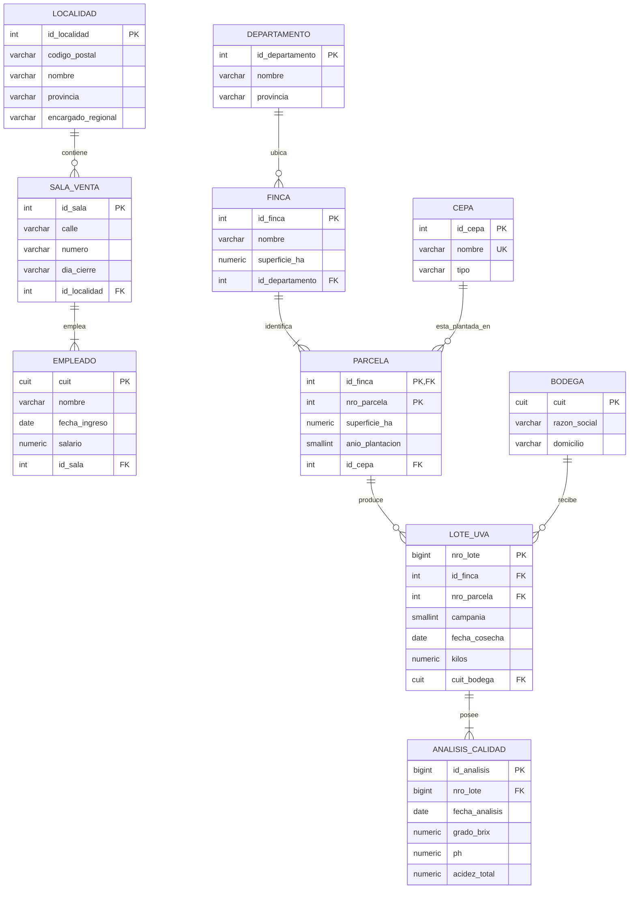
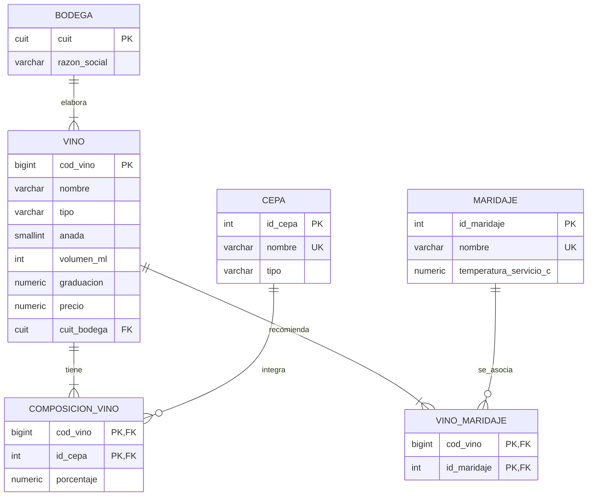
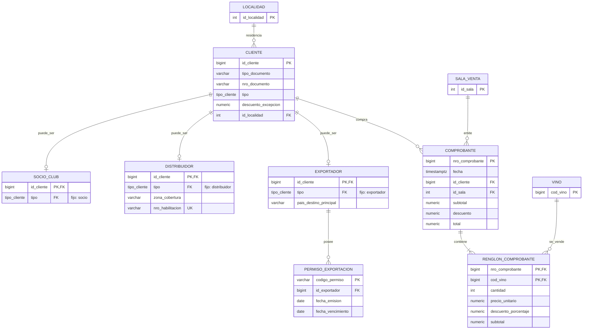
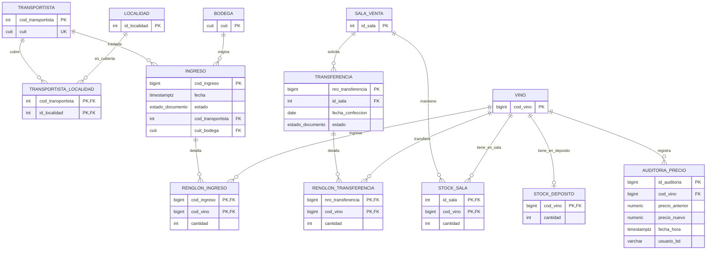

# Modelo conceptual

## 1. Alcance y notación

Este modelo deriva del escenario, las entidades mínimas y RN-01 a RN-15 de la consigna. Separa requisitos explícitos de supuestos necesarios para avanzar. No incorpora funciones, procedimientos ni triggers: cuando una cardinalidad o regla no puede protegerse con el DDL de esta etapa, se indica expresamente.

Los diagramas usan Mermaid `erDiagram` con notación pata de gallo. Como un único gráfico con treinta entidades resulta ilegible, el DER se presenta en cuatro vistas del mismo modelo; las entidades repetidas son puntos de unión, no copias.

Archivos del DER:

- fuente editable: `docs/der/*.mmd`;
- imagen exportada: `docs/der/*.png`, enlazada en cada vista;
- los bloques `mermaid` de este documento repiten la misma fuente para que GitHub los dibuje en línea.

Al modificar una vista, actualizar el `.mmd` y el bloque correspondiente, y regenerar la imagen desde `docs/der/`:

```bash
npx -y @mermaid-js/mermaid-cli@11.4.2 -i 03_clientes_ventas.mmd -o 03_clientes_ventas.png -b white -s 2
```

Convenciones de cardinalidad:

- `||`: exactamente uno;
- `o|`: cero o uno;
- `|{`: uno o más;
- `o{`: cero o más.

Mermaid no expresa que tres especializaciones sean simultáneamente totales y exclusivas, ni cardinalidades condicionadas por un estado. Tampoco agrupa visualmente los componentes de una clave candidata compuesta; por eso `UK` sólo marca candidatas de una columna y las compuestas se enumeran en las tablas del documento. Esas restricciones se explican debajo de los diagramas.

## 2. Decisiones principales y supuestos

| Tema y regla fuente | Alternativas consideradas | Solución elegida | Justificación y consecuencias |
|---|---|---|---|
| Identidad de `Localidad`: nombre, provincia y código postal; ni nombre ni CP se declaran únicos | CP como PK; nombre como PK; clave compuesta natural; ID subrogado | `id_localidad` subrogado y candidata `UNIQUE (provincia, nombre, codigo_postal)` | Un CP puede abarcar más de una localidad y los nombres se repiten entre provincias. El ID mantiene FKs cortas. La combinación evita duplicar el mismo registro, pero es un supuesto revisable si aparece un código oficial de localidad. |
| RN-02: cada localidad tiene un único encargado regional | Duplicarlo en cada sala; enlazarlo a `Empleado`; crear entidad propia; atributo de `Localidad` | Atributo obligatorio `encargado_regional` en `Localidad` | La consigna no da CUIT, datos propios ni afirma que sea empleado. Guardarlo una vez materializa `Localidad -> encargado_regional` y evita anomalías en salas. No permite distinguir homónimos ni historial; si la cátedra aporta identidad propia, se promoverá a entidad. |
| Finca conoce departamento y provincia | Ambos textos en `Finca`; catálogo `Departamento`; catálogo también para localidades | `Departamento(id, nombre, provincia)` y FK desde `Finca`; `Localidad` conserva provincia explícita | Se elimina la dependencia transitiva territorial de finca. No se inventa un departamento obligatorio para localidad, atributo que el escenario no pide. El Anexo B podrá alimentar el catálogo. |
| Parcela débil | ID global artificial; `(finca, nro_parcela)` | PK compuesta `(id_finca, nro_parcela)` | El número sólo identifica dentro de la finca y la parcela no existe sin ella. `ON DELETE CASCADE` desde finca representa dependencia existencial, aunque un lote histórico impide en la práctica eliminar una finca cosechada. |
| RN-04: una cosecha por parcela y campaña | Campaña como entidad; lote identificado por parcela/año; número de lote global | `nro_lote` como PK y candidata `(id_finca, nro_parcela, campania)` | La campaña no posee atributos propios en la consigna. **Supuesto revisable:** el número de lote es global. La candidata adicional protege el máximo de una cosecha. |
| Identidad comercial de vino | Código; `(nombre, añada, volumen)` del ejemplo; incluir bodega | Código subrogado como PK y candidata `(cuit_bodega, nombre, anada, volumen_ml)` | Dos bodegas pueden usar el mismo nombre comercial; incluir elaboradora evita una colisión artificial. Si el negocio declara nombres globalmente registrados, se podrá quitar la bodega de la candidata. |
| RN-05, composición | Lista multivaluada en vino; tabla N:M | Entidad asociativa `ComposicionVino(vino, cepa, porcentaje)` | El porcentaje depende del par completo. Cada porcentaje queda entre 0 y 100 en esta etapa; la suma 100 y la existencia de al menos una cepa requieren constraint trigger diferido. |
| Maridajes | Temperatura en `VinoMaridaje`; temperatura en `Maridaje` | `Maridaje(nombre, temperatura_servicio_c)` y N:M sin atributos | Es la ubicación explícita en la consigna. Implica una temperatura única por maridaje para todos los vinos; moverla a la asociación sería una extensión, no una corrección silenciosa. |
| Jerarquía de cliente | Tabla única; tabla sólo por subtipo; supertipo más subtipos | `Cliente` más `SocioClub`, `Distribuidor` y `Exportador` | Evita columnas inaplicables, conserva una FK uniforme desde comprobante y representa atributos específicos. La jerarquía se interpreta **total y exclusiva** porque la consigna dice que existen tres tipos. La **exclusividad** se protege de forma declarativa: cada subtipo fija su discriminador `tipo` con `CHECK` y referencia `(id_cliente, tipo)` en `Cliente`, así un cliente sólo puede tener la fila del subtipo que declara. La **totalidad** (que todo cliente tenga esa fila) no puede expresarse con una FK desde el supertipo y queda para un constraint trigger diferido en la Etapa 2. |
| RN-06 y U6, descuento 35 % | Guardar siempre 10/20/30; catálogo de políticas; sobrescribir descuento; excepción nullable | El tipo determina el descuento base; `Cliente.descuento_excepcion` sólo admite 35 % para exportador | No se duplica la política base en cada cliente. U6 establece la excepción; una función futura calculará `COALESCE(excepción, base por tipo)` y verificará que sólo califiquen exportadores con más de tres permisos. |
| Documento de cliente | Número global; par tipo/número | Candidata `(tipo_documento, nro_documento)` | El mismo texto puede existir bajo tipos documentales distintos. No se inventa un catálogo cerrado de documentos que la consigna no define. |
| Permiso de exportación | Código global; código relativo al exportador | `codigo_permiso` natural y global como PK | **Supuesto revisable:** un código identifica un permiso en todo el sistema. Si el organismo emisor sólo garantiza unicidad por exportador, la PK deberá pasar a ser compuesta. |
| Numeración de comprobantes | Global; por sala/serie | `nro_comprobante` global generado | **Supuesto revisable:** la consigna no menciona punto de venta ni serie. Una secuencia global satisface la identidad sin inventarlos. Incorporarlos después cambiaría la clave candidata y las FKs de renglón. |
| Precio y descuento históricos | Consultar siempre valores actuales; guardar copia en el renglón | `Vino.precio` actual; `RenglonComprobante.precio_unitario` y `descuento_porcentaje` históricos | Una modificación posterior del vino o cliente no altera ventas pasadas. El precio histórico no depende sólo del vino sino de la venta y, por tanto, no contradice el precio actual. |
| Importes derivados | No almacenarlos; almacenarlos todos sin control; almacenarlos con invariantes | Se almacenan subtotal neto de renglón y subtotal bruto/descuento monetario/total de cabecera | La consigna los exige y las consultas los usan. Un `CHECK` protege la fórmula del renglón y la igualdad `total = subtotal - descuento`; un trigger futuro sincronizará cabecera con el conjunto de renglones. |
| Depósito central único | Entidad `Deposito`; constante `id_deposito`; una fila por vino | `StockDeposito(cod_vino, cantidad)` | La consigna garantiza un solo depósito y no le atribuye datos propios. La PK por vino expresa como máximo una existencia central. Si aparecen varios depósitos, deberá crearse la entidad y ampliar la PK. |
| Ingresos y transferencias | Estado de texto; catálogo; ENUM | `estado_documento` con tres valores y renglones asociativos | El ENUM impide estados desconocidos. Mientras están en confección admiten `0..N` renglones; al terminar deberían tener `1..N`. Transiciones, inmutabilidad e impacto único requieren lógica posterior. |
| Auditoría de precio | Historial en API; columnas en vino; tabla de eventos | `AuditoriaPrecio` separada | Cada cambio futuro conservará precio anterior/nuevo, instante y usuario de BD. La tabla sola no audita: RN-13 queda pendiente de un trigger `AFTER UPDATE`. |
| Borrados D1 y D5 frente a stock | Revertir stock al borrar historia; impedir todo borrado; tratar borrado como depuración | Cabeceras borran sus renglones con `CASCADE`; el stock corriente no se recompone | D1 y D5 piden borrar comprobantes/ingresos históricos. Esas eliminaciones no representan anulaciones operativas, por lo que no deben crear botellas. Se pierde trazabilidad histórica de las filas eliminadas; una política de archivo sería una mejora futura si la cátedra la admite. |
| RN-14 y acciones referenciales | Cascada general; nulos; restricción en movimientos | `RESTRICT` desde movimientos, stock y auditoría hacia vino/bodega/transportista; `CASCADE` sólo en dependientes de cabecera o asociaciones | No se pierde historia ni stock por borrar un maestro. Los renglones no tienen significado sin cabecera, por eso sí se eliminan junto con ella. |
| Trazabilidad uva–vino | Crear FK lote-vino, elaboración o partida | No se crea ningún vínculo | La consigna sólo registra bodega destino del lote y bodega elaboradora del vino. No permite afirmar qué lote produjo qué vino. Ese seguimiento exige una extensión explícita con proceso de elaboración y cantidades. |
| Fechas de operación | Todo `DATE`; todo `TIMESTAMP`; tiempo con zona | Cosecha, análisis, altas, permisos y confección usan `DATE`; venta, ingreso y auditoría usan `TIMESTAMPTZ` | Los primeros se definen por día; los segundos son eventos operativos/auditables. PostgreSQL conservará instantes y la aplicación podrá presentarlos en `America/Buenos_Aires`. |

## 3. Entidades, identificadores y atributos

Las claves candidatas alternativas se muestran además de la PK. Una clave subrogada sólo resuelve identidad; no se usa como argumento de normalización.

| Entidad | Significado | Identificador y candidatas | Atributos descriptivos principales |
|---|---|---|---|
| `Departamento` | Catálogo territorial de las fincas | PK `id_departamento`; candidata `(nombre, provincia)` | nombre, provincia |
| `Localidad` | Localidad comercial/postal | PK `id_localidad`; candidata `(provincia, nombre, codigo_postal)` | código postal, nombre, provincia, encargado regional |
| `SalaVenta` | Punto de venta de la red | PK `id_sala`; candidata `(id_localidad, calle, numero)` | calle, número, día de cierre |
| `Empleado` | Persona que trabaja en una sala | PK natural `cuit` | nombre, fecha de ingreso, salario |
| `Finca` | Unidad agrícola del grupo | PK `id_finca`; no se presume nombre único | nombre, superficie total |
| `Parcela` | División dependiente de una finca | PK débil `(id_finca, nro_parcela)` | superficie, año de plantación, cepa única |
| `Cepa` | Variedad de uva | PK `id_cepa`; candidata `nombre` | tipo tinta/blanca |
| `LoteUva` | Resultado de cosechar una parcela en una campaña | PK natural `nro_lote`; candidata `(id_finca, nro_parcela, campania)` | campaña, fecha, kilos, bodega destino |
| `AnalisisCalidad` | Medición practicada a un lote | PK `id_analisis` | fecha, Brix, pH, acidez total |
| `Bodega` | Elaboradora del grupo | PK natural `cuit` | razón social, domicilio |
| `Vino` | Producto vendible en una presentación | PK `cod_vino`; candidata `(cuit_bodega, nombre, anada, volumen_ml)` | tipo, graduación, precio actual |
| `ComposicionVino` | Participación de una cepa en un vino | PK `(cod_vino, id_cepa)` | porcentaje de corte |
| `Maridaje` | Recomendación gastronómica catalogada | PK `id_maridaje`; candidata `nombre` | temperatura de servicio |
| `VinoMaridaje` | Asociación de un vino con una recomendación | PK `(cod_vino, id_maridaje)` | sin atributos propios según consigna |
| `Cliente` | Datos comunes de cualquier comprador | PK `id_cliente`; candidata `(tipo_documento, nro_documento)` | nombre/razón social, dirección, localidad, alta, tipo, excepción de descuento |
| `SocioClub` | Cliente consumidor final | PK `id_cliente`; FK `(id_cliente, tipo)` | discriminador fijo `socio`; no tiene atributos exclusivos en la consigna |
| `Distribuidor` | Cliente de distribución | PK `id_cliente`; candidata `nro_habilitacion`; FK `(id_cliente, tipo)` | discriminador fijo `distribuidor`, zona de cobertura, habilitación |
| `Exportador` | Cliente de exportación | PK `id_cliente`; FK `(id_cliente, tipo)` | discriminador fijo `exportador`, país de destino principal |
| `PermisoExportacion` | Autorización de un exportador | PK natural `codigo_permiso` | emisión, vencimiento |
| `Comprobante` | Cabecera de una venta | PK global `nro_comprobante` | fecha, cliente, sala, subtotal bruto, descuento monetario, total |
| `RenglonComprobante` | Vino incluido en una venta | PK `(nro_comprobante, cod_vino)` | cantidad, precio histórico, descuento histórico, subtotal neto |
| `Transportista` | Empresa que traslada ingresos | PK `cod_transportista`; candidata `cuit` | razón social, email, teléfono, domicilio |
| `TransportistaLocalidad` | Cobertura territorial del transportista | PK `(cod_transportista, id_localidad)` | sin atributos propios |
| `Ingreso` | Documento de entrada al depósito | PK `cod_ingreso` | fecha, estado, transportista, bodega origen |
| `RenglonIngreso` | Vino y botellas de un ingreso | PK `(cod_ingreso, cod_vino)` | cantidad |
| `Transferencia` | Solicitud del depósito hacia una sala | PK `nro_transferencia` | sala, fecha de confección, estado |
| `RenglonTransferencia` | Vino y botellas solicitadas | PK `(nro_transferencia, cod_vino)` | cantidad |
| `StockSala` | Existencia actual de un vino en una sala | PK `(id_sala, cod_vino)` | cantidad no negativa |
| `StockDeposito` | Existencia actual de un vino en el único depósito | PK/FK `cod_vino` | cantidad no negativa |
| `AuditoriaPrecio` | Evento histórico de cambio de precio | PK `id_auditoria` | vino, precio anterior/nuevo, instante, usuario BD |

`schema_migration` no aparece en el DER porque es metadato técnico del mecanismo de despliegue, no una entidad del dominio.

## 4. DER editable y visualizable

### 4.1 Red comercial y producción de uva

Imagen: [01_red_comercial_produccion.png](der/01_red_comercial_produccion.png) · fuente: [01_red_comercial_produccion.mmd](der/01_red_comercial_produccion.mmd)



### 4.2 Vinos, composición y maridajes

Imagen: [02_vinos_composicion_maridajes.png](der/02_vinos_composicion_maridajes.png) · fuente: [02_vinos_composicion_maridajes.mmd](der/02_vinos_composicion_maridajes.mmd)



### 4.3 Clientes y ventas

Imagen: [03_clientes_ventas.png](der/03_clientes_ventas.png) · fuente: [03_clientes_ventas.mmd](der/03_clientes_ventas.mmd)



Las tres relaciones `puede_ser` deben leerse juntas: en el modelo conceptual cada cliente pertenece a **exactamente uno** de los tres subtipos. Los tres `o|` individuales sólo muestran que ninguna rama es obligatoria por sí sola; Mermaid no expresa la disyunción total/exclusiva.

La FK de cada subtipo es compuesta, `(id_cliente, tipo) -> CLIENTE(id_cliente, tipo)`, y el `tipo` del subtipo es constante. Por eso la exclusividad ya queda garantizada por el esquema: a lo sumo una rama puede existir para cada cliente, y es la que coincide con `CLIENTE.tipo`. Falta la totalidad, que la Etapa 2 resolverá con un constraint trigger diferido.

### 4.4 Logística, stock y auditoría

Imagen: [04_logistica_stock_auditoria.png](der/04_logistica_stock_auditoria.png) · fuente: [04_logistica_stock_auditoria.mmd](der/04_logistica_stock_auditoria.mmd)



## 5. Cardinalidades y participación

| Relación | Extremo A | Extremo B | Observación |
|---|---:|---:|---|
| Localidad–Sala | Localidad `0..N` salas | Sala `1..1` localidad | RN-02; la FK obligatoria protege el extremo de sala. |
| Sala–Empleado | Sala `1..N` empleados | Empleado `1..1` sala | La consigna dice “varios”; exigir al menos uno por sala requiere lógica entre filas. |
| Departamento–Finca | Departamento `0..N` fincas | Finca `1..1` departamento | Provincia depende del departamento catalogado. |
| Finca–Parcela | Finca `1..N` parcelas | Parcela `1..1` finca | Relación identificadora de entidad débil. |
| Cepa–Parcela | Cepa `0..N` parcelas | Parcela `1..1` cepa | RN-04; una sola FK por parcela. |
| Parcela–Lote | Parcela `0..N` lotes | Lote `1..1` parcela | `UNIQUE (parcela, campaña)` limita a uno por año. |
| Bodega–Lote | Bodega `0..N` lotes | Lote `1..1` bodega destino | No implica que el lote esté asociado a un vino particular. |
| Lote–Análisis | Lote `1..N` análisis | Análisis `1..1` lote | La FK no puede exigir el mínimo uno del lado padre. |
| Bodega–Vino | Bodega `1..N` vinos | Vino `1..1` bodega | El mínimo de la bodega es conceptual; durante la carga puede existir sin vinos. |
| Vino–Cepa | Vino `1..N` cepas | Cepa `0..N` vinos | N:M materializada por composición, con porcentaje. |
| Vino–Maridaje | Vino `1..N` maridajes | Maridaje `0..N` vinos | N:M sin atributos propios. |
| Localidad–Cliente | Localidad `0..N` clientes | Cliente `1..1` localidad | La dirección textual no sustituye la FK. |
| Cliente–subtipo | Cliente `1..1` subtipo total/exclusivo | Cada subtipo `1..1` cliente | Máximo uno protegido por FK compuesta y discriminador fijo; mínimo uno (totalidad) pendiente de constraint trigger diferido. |
| Exportador–Permiso | Exportador `0..N` permisos | Permiso `1..1` exportador | “Puede tener varios” no obliga a tener alguno. |
| Cliente–Comprobante | Cliente `0..N` comprobantes | Comprobante `1..1` cliente | `RESTRICT` conserva ventas al intentar borrar cliente. |
| Sala–Comprobante | Sala `0..N` comprobantes | Comprobante `1..1` sala | Lugar efectivo de venta. |
| Comprobante–Renglón | Comprobante `1..N` renglones cerrado | Renglón `1..1` comprobante | Cabecera recién creada puede estar transitoriamente vacía; trigger posterior controlará cierre. |
| Vino–Renglón de venta | Vino `0..N` renglones | Renglón `1..1` vino | La PK compuesta impide repetir el vino dentro del comprobante. |
| Transportista–Localidad | Ambos `0..N` | Asociación `1..1` a cada padre | N:M de cobertura. |
| Transportista/Bodega–Ingreso | Cada maestro `0..N` ingresos | Ingreso `1..1` de cada uno | `RESTRICT` implementa RN-14. |
| Ingreso–Renglón | Ingreso `0..N` en confección, `1..N` al terminar | Renglón `1..1` ingreso | Cardinalidad mínima condicionada por estado. |
| Sala–Transferencia | Sala `0..N` transferencias | Transferencia `1..1` sala | Solicitud desde el depósito único. |
| Transferencia–Renglón | Transferencia `0..N` en confección, `1..N` al terminar | Renglón `1..1` transferencia | Cardinalidad mínima condicionada por estado. |
| Sala/Vino–StockSala | Cada uno `0..N` filas | Fila `1..1` de cada padre | Ausencia de fila y cantidad cero se distinguirán en las funciones futuras. |
| Vino–StockDeposito | Vino `0..1` fila central | Fila `1..1` vino | Un solo depósito; se prevé crear fila al ingresar el vino. |
| Vino–Auditoría | Vino `0..N` eventos | Evento `1..1` vino | Se llenará automáticamente en la siguiente etapa. |

## 6. Reglas conceptuales no expresadas por el DER o no protegidas aún

- Totalidad de la jerarquía: todo cliente debe tener la fila del subtipo que declara. La exclusividad y la coincidencia con `Cliente.tipo` ya están protegidas por la FK compuesta.
- Al menos una composición por vino y suma exacta de 100 % (RN-05).
- Al menos un maridaje por vino y un análisis por lote.
- Al menos un empleado por sala y una parcela por finca en estado estable.
- Descuento base 10/20/30, excepción 35 % sólo para exportadores con más de tres permisos y copia histórica al vender (RN-06/U6).
- Coincidencia de importes de cabecera con todos los renglones (RN-08).
- Disponibilidad y descuento atómico de stock al vender (RN-09).
- Transiciones sin retroceso, impacto único de ingresos/transferencias e inmutabilidad de fecha (RN-10/RN-11).
- Prohibición de editar renglones fuera de `en_confeccion` (RN-12).
- Inserción automática en auditoría al cambiar el precio (RN-13).
- Mínimo de un renglón antes de terminar un ingreso o una transferencia.

Estas reglas no se presentan como resueltas por la mera existencia de columnas. Se implementarán y probarán con funciones, procedimientos y triggers en la etapa de lógica.
